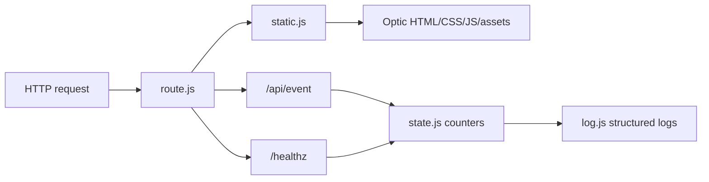
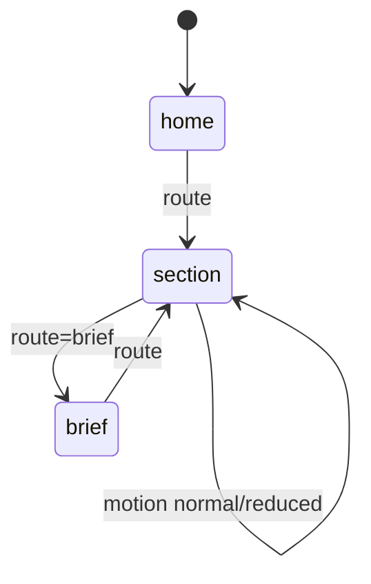

# Optic

Private perception intelligence for high-stakes professional identity.

## Setup

```sh
npm install
npm test
npm start
```

The local server listens on `PORT` and `HOST`.

```sh
PORT=8080 HOST=127.0.0.1 npm start
```

Open `http://127.0.0.1:8080/`.

## Project Structure

```text
.
|-- optic.html
|-- optic-investors.html
|-- assets/optic/
|-- docs/optic-whitepaper.md
|-- docs/legal/
|-- scripts/build-optic-whitepaper.mjs
|-- src/
|   |-- cfg.js
|   |-- http.js
|   |-- log.js
|   |-- optic_app.js
|   |-- optic_content.js
|   |-- optic_investor_app.js
|   |-- route.js
|   |-- state.js
|   `-- static.js
|-- styles/optic.css
|-- tests/
`-- qa/
```

`qa/` contains preserved Optic review captures from the source workspace.

## Architecture



## State Machine

The browser uses `opticReducer` for immutable route, motion, and view
transitions.



The server uses a small reducer for counters:

```text
req -> events -> errors
```

## Runtime

- `GET /` serves the public Optic page.
- `GET /investors` serves the investor memo.
- `GET /legal` serves the legal website.
- `GET /terms`, `/privacy`, `/cookies`, `/app-privacy`, and
  `/notice-at-collection` serve public legal pages.
- `GET /docs/legal/*.md` serves source legal drafts.
- `POST /api/event` accepts telemetry and never blocks page use.
- `GET /healthz` returns health and metrics counters.
- Static routes are allow-listed and path traversal is rejected.

## Build

```sh
npm run build
```

The build regenerates `docs/optic-whitepaper.md` and writes a static
`public/` bundle for hosts that do not run Node.

## Legal Package

Optic's MVP legal stack lives in `docs/legal/`.

- B2C-first, with light future business-feature language.
- Recurring subscriptions and optional free trial mechanics.
- Analytics-only MVP with no targeted advertising.
- No minors or regulated sensitive-data workflows.
- GDPR, UK GDPR, and Swiss-style rights language.
- AI outputs and inferences are probabilistic and informational only.
