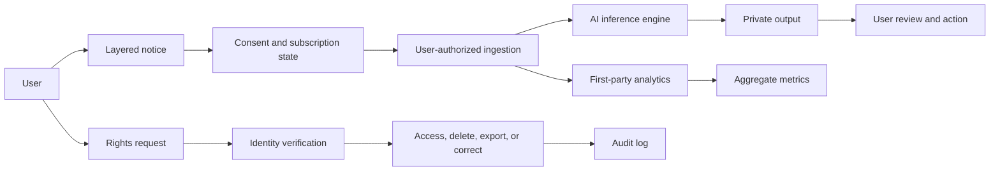
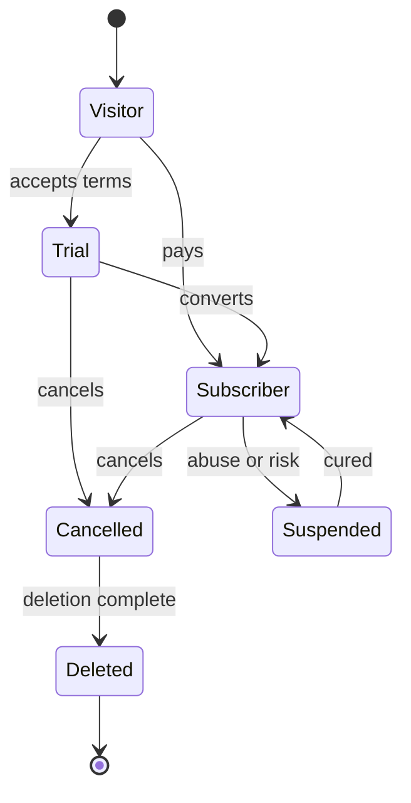

# Optic Legal Stack

Effective date: May 4, 2026

This package is a counsel-ready baseline for Optic's MVP legal posture.
It assumes Optic is a mixed B2C and B2B product, but launches B2C-first
with optional business features later.

This is not legal advice. Final publication requires licensed counsel
review and confirmation that product behavior matches these promises.

## Locked Posture

- B2C-first privacy and inference product.
- Recurring subscriptions, with optional free trials.
- Analytics-only for MVP. No retargeting or targeted advertising.
- No minors. The service is not designed for users under 18.
- No regulated sensitive-data workflows.
- No HIPAA, education, marketplace, credit, housing, or employment product.
- GDPR, UK GDPR, and Swiss FADP aware from day one.
- AI outputs, inferences, models, and automation are probabilistic.
- Business features may receive later addenda.

## Data Flow



## State Machine



## File Tree

```text
docs/legal/
|-- README.md
|-- terms.md
|-- privacy.md
|-- cookie-policy.md
|-- short-privacy-notice.md
|-- business-features.md
|-- rights-workflow.md
`-- compliance-roadmap.md
```

## Publication Order

1. Publish `terms.md`, `privacy.md`, and `cookie-policy.md`.
2. Add `short-privacy-notice.md` near signup, checkout, and import flows.
3. Keep `business-features.md` as a lightweight bridge until B2B launches.
4. Implement `rights-workflow.md` before accepting EEA, UK, Swiss, or
   state privacy requests at scale.
5. Track operational work in `compliance-roadmap.md`.

## Operating Constraints

Do not add retargeting pixels, ad audiences, or cross-context behavioral
advertising without replacing the advertising language across this package.
Do not market the service to minors or schools without a new minors and
education review. Do not request health, biometric, financial, precise
geolocation, school-record, or marketplace/seller data unless a dedicated
workflow and legal addendum exists.

## Key Sources

- <a
  href="https://oag.ca.gov/privacy/ccpa">
  California CCPA notice guidance
  </a>
- <a
  href="https://coag.gov/resources/colorado-privacy-act/">
  Colorado Privacy Act resources
  </a>
- <a
  href="https://portal.ct.gov/ag">
  Connecticut Data Privacy Act
  </a>
- <a
  href="https://www.doj.state.or.us/consumer-protection/">
  Oregon Consumer Privacy Act resources
  </a>
- <a
  href="https://www.ftc.gov/legal-library/browse/rules/negative-option-rule">
  FTC negative option rulemaking
  </a>
- <a
  href="https://www.ftc.gov/business-guidance">
  FTC CAN-SPAM guide
  </a>
- <a
  href="https://commission.europa.eu/law/law-topic/data-protection_en">
  European Commission GDPR rights
  </a>
- <a
  href="https://www.kmu.admin.ch/kmu/en/home.html">
  Swiss nFADP overview
  </a>
