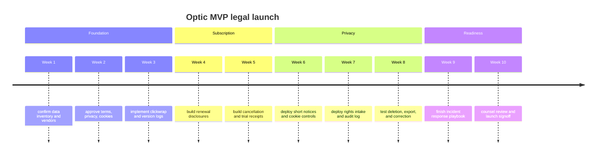

# Optic Compliance Roadmap

Effective date: May 4, 2026

This roadmap turns the legal documents into product and engineering work.

## Roadmap

## Checklist

- Data inventory.
  Owner: Legal + Eng. Priority: Critical. Done when categories, systems,
  vendors, and retention are mapped.
- Clickwrap.
  Owner: Product + Eng. Priority: Critical. Done when version, timestamp,
  user ID, IP, and action are logged.
- Subscription UX.
  Owner: Product + Billing. Priority: Critical. Done when trial, renewal,
  price, and cancellation are clear.
- Cancellation.
  Owner: Product + Billing. Priority: Critical. Done when users can cancel
  through the stated channel.
- Analytics review.
  Owner: Eng + Legal. Priority: High. Done when no ad pixels, retargeting,
  or ad audiences exist.
- Cookie controls.
  Owner: Eng + Legal. Priority: High. Done when non-essential cookies are
  gated where required.
- Rights workflow.
  Owner: Support + Eng. Priority: High. Done when intake, verification,
  export, deletion, correction, and appeal work.
- Sensitive data guardrails.
  Owner: Product + Eng. Priority: High. Done when UI warns against regulated
  sensitive imports.
- AI output review.
  Owner: Product + Legal. Priority: High. Done when output disclaimers are
  visible in high-risk contexts.
- Retention.
  Owner: Eng + Legal. Priority: High. Done when retention periods are mapped
  and deletion jobs are tested.
- Incident response.
  Owner: Security + Legal. Priority: High. Done when escalation, evidence,
  and notice templates are ready.
- Marketing.
  Owner: Marketing + Legal. Priority: Medium. Done when unsubscribe and
  suppression list handling is tested.
- International transfers.
  Owner: Legal + Security. Priority: Medium. Done when SCC path and vendor
  transfer review are ready.

## Engineering Requirements

- Store legal acceptance events immutably.
- Version every public legal document.
- Record subscription consent and cancellation events.
- Maintain a first-party analytics allow-list.
- Block retargeting and targeted advertising tags for MVP.
- Tag imported data by source, purpose, and user.
- Keep generated inferences connected to source snapshots.
- Provide export, delete, and correction jobs.
- Retry failed privacy jobs with backoff.
- Alert on dead letter queue entries.
- Preserve incident evidence and affected data categories.

## Launch Gate

Do not launch paid subscriptions until the checkout and cancellation flow
matches the Terms. Do not launch EEA, UK, or Swiss availability until rights
intake, deletion, export, and cookie controls are working. Do not add
targeted advertising until the legal package and consent stack are rewritten.
